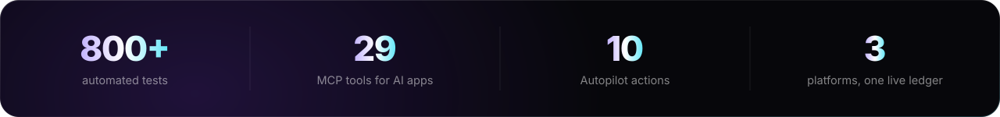
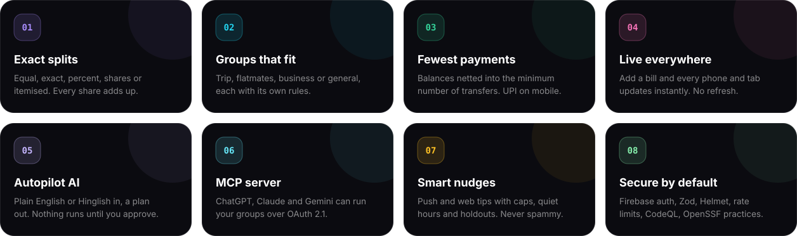
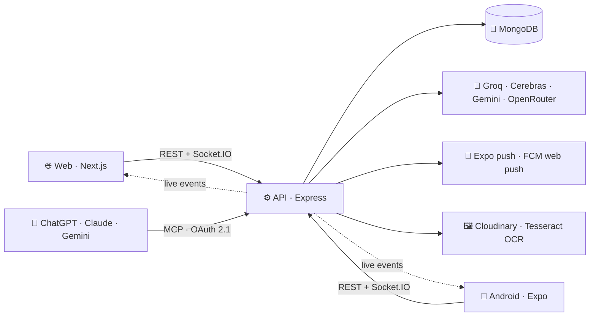

<div align="center">

<a href="https://split.elitecrew.online">
  
</a>

<br />

[](https://github.com/Gautam5514/Split-Expense/actions/workflows/ci.yml)
[](https://github.com/Gautam5514/Split-Expense/actions/workflows/codeql.yml)
[](https://www.bestpractices.dev/projects/14650)
[](LICENSE)
[](https://nodejs.org)
[](CONTRIBUTING.md)
[](https://github.com/Gautam5514/Split-Expense/labels/good%20first%20issue)

**[🌐 Web app](https://split.elitecrew.online)** &nbsp;·&nbsp;
**[📱 Android](https://play.google.com/store/apps/details?id=com.kunal.splitapp)** &nbsp;·&nbsp;
**[🧭 Autopilot](https://split.elitecrew.online/features/autopilot)** &nbsp;·&nbsp;
**[🛰️ MCP server](https://split.elitecrew.online/mcp)** &nbsp;·&nbsp;
**[📘 API docs](docs/API.md)** &nbsp;·&nbsp;
**[📦 Mobile repo](https://github.com/Gautam5514/splitApp)**

<br />



</div>

---

## Contents

- [Highlights](#highlights)
- [Live everywhere](#live-everywhere)
- [Autopilot, the AI agent](#autopilot-the-ai-agent)
- [MCP server for ChatGPT, Claude and Gemini](#mcp-server-for-chatgpt-claude-and-gemini)
- [Smart notifications](#smart-notifications)
- [Architecture](#architecture)
- [Tech stack](#tech-stack)
- [Run it locally](#run-it-locally)
- [Tests and quality](#tests-and-quality)
- [Security](#security)
- [Contributing](#contributing)

---

## Highlights



<details>
<summary><b>The details behind each card</b></summary>

<br />

| | |
|---|---|
| **Exact splits** | Equal, exact, percent, shares or itemised. Rounding leftovers go to the payer, so every bill adds up to the paisa. |
| **Groups that fit** | Trip (budget + dates), flatmates (monthly bill day), business (receipts required) or general, each with its own categories and default split. Settings lock after the first expense so old splits stay correct. |
| **Fewest payments** | Balances are netted and routed through the minimum number of transfers. Settle-ups are two-sided: one person claims, the other confirms. One-tap UPI on mobile. |
| **Live everywhere** | Socket.IO pushes every change to every open phone and browser tab. See [Live everywhere](#live-everywhere). |
| **Autopilot AI** | Chat in English or Hinglish. It drafts a plan with every share, and nothing changes until you approve. |
| **MCP server** | 29 tools so ChatGPT, Claude, Gemini and Cursor can run your groups, over OAuth 2.1. |
| **Smart nudges** | Festival, monthly and trip-season tips via push and web push, with frequency caps, quiet hours and holdout groups. |
| **Secure by default** | Firebase auth, Zod validation, Helmet, per-user rate limits, NoSQL-injection sanitising, CodeQL and OpenSSF practices. |

</details>

---

## Live everywhere

Add a bill on the web and it appears on every member's phone a moment later. No refresh, no restart, no clearing the cache.

| What changes | Who sees it live |
|---|---|
| Expenses, settle-ups, recurring bills | Everyone with the group open, plus every member's home screen |
| Members, invites, join requests, settings, photo | The group page, the creator's pending list, the invitee's invites |
| New, completed or deleted groups | Every member's group list, on web and app |
| Notifications | Every device you're signed in on, not just the last one |

The connection heals itself. It reconnects forever with a fresh token, re-joins every open group, and refetches whatever it missed when the app comes back from the background, the tab becomes visible again or the network returns.

---

## Autopilot, the AI agent



A chat agent that turns plain English or Hinglish into a **reviewable plan**, and runs it only after you approve. It lives in a floating widget on the web and a full screen in the Android app. **[See the feature page →](https://split.elitecrew.online/features/autopilot)**

```text
"rent 21000"  →  plan: Rent ₹21,000, paid by you, split equally (4 people)  →  "make it 24000"  →  Approve ₹24,000  →  done, verified
```

| ✏️ Changes (always need approval) | 🔎 Answers (read-only, instant) |
|---|---|
| Create a group (picks trip / flat / business) | Who owes whom, with the simplest settle-up |
| Add people (contacts join, others get an invite) | Your balance across every group |
| Record an expense you paid (group's default split) | Recent expenses, or search ("food", "taxi") |
| Set a trip budget and budget alerts | |
| Delete an expense you added, or a group you created | |

**Why it's safe and smart**

- **Understands casual language.** "petrol 1.5k", "maine 900 diye taxi ke liye", "pizza 600 with Aman and Priya". It fills safe defaults and asks one short question only when something is truly missing.
- **Instant corrections.** While a plan waits: "make it 4000", "Rahul ko hata do", "Priya bhi", "call it Team dinner". No retyping.
- **Approval-gated execution.** Plans are hashed and versioned, and approvals expire after 24 hours. Every step runs in a MongoDB transaction, is read back to verify it, and is idempotent on retry. Deletes, and amounts of ₹50,000 or more, need the button, not a typed "yes".
- **Grounded numbers.** Every amount the model returns must appear in your message, so "3600" can never silently become "36000".
- **Reliable on free models.** Groq → Cerebras → Gemini → OpenRouter, with per-model cooldowns, a 15 s budget and one repair retry. When every provider is busy, an offline parser still handles common requests.

Switches: `AUTOPILOT_ENABLED`, `AUTOPILOT_WRITES_ENABLED`, plus any one provider key (e.g. `GROQ_API_KEY`).
Details and threat model: [`docs/autopilot/`](docs/autopilot/README.md) · [`docs/agent-threat-model.md`](docs/agent-threat-model.md)

---

## MCP server for ChatGPT, Claude and Gemini

A remote [Model Context Protocol](https://modelcontextprotocol.io) endpoint (Streamable HTTP, OAuth 2.1). It lets AI assistants **run** your SplitEase account, not just read it: create groups, add bills, settle up, handle invites and monthly bills.

```jsonc
{ "mcpServers": { "splitease": { "url": "https://api.split.elitecrew.online/mcp" } } }
```

Add the URL as a custom connector in ChatGPT, Claude or Cursor, or use it from the Gemini CLI. Sign-in is the normal SplitEase login page.

| Area | Tools |
|---|---|
| 👤 Account | `get_me` · `get_overall_summary` · `get_spending_insights` · `ping` |
| 👥 Groups | `list_groups` · `get_group` · `create_group` · `update_group_settings` · `add_members` · `remove_member` · `get_invite_link` · `join_group` · `complete_group` · `leave_group` · `delete_group` |
| 🧾 Expenses | `add_expense` · `list_expenses` · `get_expense` · `get_group_summary` |
| 🤝 Settling | `get_balances` · `settle_up` · `list_pending_settlements` · `respond_to_settlement` |
| ✉️ Invites | `list_my_invites` · `respond_to_invite` |
| 🔁 Monthly bills | `list_recurring_bills` · `add_recurring_bill` · `update_recurring_bill` · `delete_recurring_bill` |

- **Same rules as the app.** Write tools call the exact REST controllers the web and app use, through an in-process bridge. Validation, permissions, settings lock, consent and live updates are identical, so a bill added from ChatGPT shows up in the app instantly.
- **Talk naturally.** Groups by name ("goa" finds "Goa Trip"), people by name, email or "me". When a name is ambiguous, the tool returns the candidates instead of guessing.
- **Built for AI clients.** Every tool has `readOnlyHint` / `destructiveHint` annotations, and server instructions explain the rules to the model. A duplicate guard stops retried requests from adding the same bill twice, and `delete_group` needs the group's exact name as confirmation.

Contracts and auth: [`docs/mcp-tool-contracts.md`](docs/mcp-tool-contracts.md) · [`docs/MCP-OAUTH.md`](docs/MCP-OAUTH.md)

---

## Smart notifications

Gentle, scheduled tips that bring people back without spamming them. **No setup needed:** they run automatically and can be paused from **Admin → Notifications**.

| Tip | When (IST) | Example |
|---|---|---|
| New month | 1st of every month, 10:00 | "Naya mahina, naya hisaab. Is mahine ka rent aur bills abhi add karo." |
| Weekend | One Sunday a month, 12:30 | "Sunday plans? Pay once, split in seconds." |
| Trip season | Nov and Dec, 19:30 | "Puri is calling. Plan a winter getaway, or go big with Goa." |

- **Respectful:** at most 1 a day and 5 in any 30 days, never between 21:00 and 09:00, new users wait two days, and people already planning a trip get no trip tips.
- **Personal:** first name and nearby destinations from the profile's state or city (no GPS), in English and Hinglish variants.
- **Exactly once:** each send is claimed in a unique index first, and the frequency cap is one atomic write per person, so restarts or a second server never double-send.
- **Measurable:** a 10% holdout per campaign and open tracking per variant, visible on the admin page.

Tapping a tip opens Autopilot with a ready draft ("Create group Puri Trip, budget 30000").

---

## Architecture



```text
Split/
├── backend/                  Express API (:5000 locally)
│   ├── controllers/          groups, expenses, balances, invites, notifications …
│   ├── modules/autopilot/    planner, LLM chain, approval + transactional execution
│   ├── modules/engagement/   scheduled tips: schedule, copy, runner, admin
│   ├── services/mcp/         MCP tools, controller bridge, name resolver
│   ├── utils/realtime.js     live-update fan-out to groups and users
│   └── tests/                Jest: unit, property-based, DB integration
├── frontend/                 Next.js web app (:3000)
└── docs/                     API, Autopilot, MCP, security, invariants
```

The mobile app lives in its own repo, **[Gautam5514/splitApp](https://github.com/Gautam5514/splitApp)**, and talks to the same API.

---

## Tech stack

<p align="center">
  
</p>

| Layer | Built with |
|---|---|
| **Web** |      |
| **Mobile** |     |
| **API** |      |
| **Data** |    |
| **AI** |      |
| **Auth & push** |    |
| **Quality** |     |
| **Ship** |     |

---

## Run it locally

You need **Node 22** (18+ works) and a MongoDB connection string. A free [Atlas](https://www.mongodb.com/atlas) cluster or a local `mongod` both work.

```bash
git clone https://github.com/Gautam5514/Split-Expense.git && cd Split-Expense

# 1. API
cd backend && npm install
cp .env.example .env          # fill in MONGO_URI and auth values
npm run dev                   # http://localhost:5000

# 2. Web (new terminal)
cd frontend && npm install
cp .env.example .env.local
npm run dev                   # http://localhost:3000
```

Only need the basics? Leave Firebase push, Cloudinary, SMTP and AI keys empty; they only matter for push, uploads, email and AI features. To try Autopilot, add `AUTOPILOT_ENABLED=true`, `AUTOPILOT_WRITES_ENABLED=true` and one free key such as `GROQ_API_KEY` (plus `NEXT_PUBLIC_AUTOPILOT_ENABLED=true` for the web build).

> [!WARNING]
> Never commit `.env` or `.env.local`. They are git-ignored; the `.env.example` files are templates.

---

## Tests and quality

```bash
cd backend  && npm test           # 660+ unit + property-based tests (fast-check)
cd backend  && npm run test:int   # real-MongoDB integration: settings lock, group security, MCP tools
cd frontend && npm test           # component tests, including the Autopilot widget
```

> [!TIP]
> Integration tests need a throwaway database: `mongod --dbpath /tmp/db --port 27099`, then
> `MONGO_TEST_URI=mongodb://127.0.0.1:27099/splitease_test npm run test:int`. Never point them at a real database.

CI runs both suites, linting and dependency audits on every pull request, and CodeQL scans for security issues. The mobile repo has its own 220+ tests.

---

## Security

| | |
|---|---|
| 🔐 **Identity** | Firebase-verified tokens only; MCP uses OAuth 2.1 with PKCE, hashed tokens and refresh rotation |
| 🧱 **Input** | Zod schemas, NoSQL-injection sanitising, size limits, SSRF-safe receipt URLs |
| 🚦 **Abuse** | Per-user and per-token rate limits on the API, Autopilot and MCP |
| 💸 **Money** | Only you can be the payer of your expenses; settle-ups are two-sided; [financial invariants](docs/financial-invariants.md) are tested |
| 🔍 **Supply chain** | CodeQL, Dependabot, npm audit in CI, [OpenSSF Best Practices](https://www.bestpractices.dev/projects/14650) |

Found something? Please report it privately; see the [security policy](SECURITY.md). More: [secure development guide](docs/SECURE_DEVELOPMENT.md) · [permissions matrix](docs/permissions-matrix.md) · [release process](docs/RELEASING.md).

---

## Contributing

New to open source? Welcome. Code, docs, bug reports and ideas all count.

1. Fork, then branch: `git checkout -b feat/my-change`
2. Make the change, with tests where it makes sense
3. Open a pull request

Start with [CONTRIBUTING.md](CONTRIBUTING.md) and the [`good first issue`](https://github.com/Gautam5514/Split-Expense/labels/good%20first%20issue) label.

<div align="center">

<br />

**If SplitEase helped you, a ⭐ helps others find it.**

[MIT](LICENSE) © 2026 Gautam Pandit

</div>
