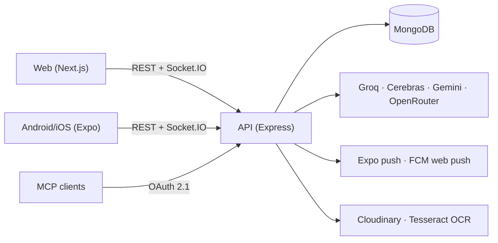

<div align="center">


# SplitEase · Split‑Expense

### Split bills. Not friendships.

Groups, trips and flat bills in one place: log an expense in seconds, see who owes whom,
settle in the fewest payments, and let **Autopilot** do the admin for you, always with your approval.

[](https://github.com/Gautam5514/Split-Expense/actions/workflows/ci.yml)
[](https://github.com/Gautam5514/Split-Expense/actions/workflows/codeql.yml)
[](https://www.bestpractices.dev/projects/14650)
[](LICENSE)
[](https://github.com/Gautam5514/Split-Expense/labels/good%20first%20issue)

**[Web app](https://split.elitecrew.online)** · **[Android app](https://play.google.com/store/apps/details?id=com.kunal.splitapp)** · **[Mobile repo](https://github.com/Gautam5514/splitApp)** · **[API docs](docs/API.md)** · **[Autopilot docs](docs/autopilot/README.md)**

</div>

---

## Contents

- [Highlights](#highlights)
- [Autopilot, the AI agent](#autopilot-the-ai-agent)
- [Smart notifications](#smart-notifications)
- [MCP server](#mcp-server)
- [Architecture](#architecture)
- [Run it locally](#run-it-locally)
- [Tests and quality](#tests-and-quality)
- [Contributing](#contributing)

---

## Highlights

| | |
|---|---|
| 🧮 **Exact splits** | Equal, exact, percent, shares or itemised. Every share is computed in integer paise, so totals always add up. |
| 👥 **Groups that fit** | Trip, flat (roommate), business or general groups, each with its own categories, budget and default split. |
| ⚡ **Settle in fewer payments** | Balances are netted and routed through the minimum number of transfers, with one-tap UPI on mobile. |
| 🧭 **Autopilot** | Type "rent 20000" or "dinner 3000 Rahul ko chhod ke". Autopilot drafts the plan, you approve, it does the work. |
| 🔔 **Live and push** | Socket.IO updates, Android push (Expo/FCM) and web push, with smart monthly, weekend and trip-season tips. |
| 🛰️ **MCP server** | Claude, Cursor and other MCP clients can read your data over OAuth 2.1, scoped to your account. |
| 🧾 **Receipt OCR** | Tesseract.js reads bills so expenses can start from a photo. |
| 🔐 **Secure by default** | Firebase auth, Helmet, Zod validation, per-user rate limits, CodeQL and OpenSSF practices. |

---

## Autopilot, the AI agent

A chat agent that turns plain English or Hinglish into a **reviewable plan**, then executes it
only after you approve. Lives in a floating widget on the web and a full screen in the app.

```
"rent 21000"  ->  plan: Rent ₹21,000, paid by you, split equally (4 people)  ->  "make it 24000"  ->  Approve ₹24,000  ->  done, verified
```

**What it can do**

| Changes (always need approval) | Answers (read-only, instant) |
|---|---|
| Create a group (picks trip / flat / business type) | Who owes whom, with the simplest settle-up |
| Add people (contacts join, others get an invite) | Your balance across every group |
| Record an expense you paid (uses the group's default split) | Recent expenses, or search ("food", "taxi") |
| Set a trip budget and budget alerts | |
| Delete an expense you added, or a group you created (red confirmation) | |

**How it stays safe and smart**

- **Understands casual language.** "petrol 1.5k", "maine 900 diye taxi ke liye", "pizza 600 with Aman and Priya". It fills in safe defaults and asks one short question only when something is truly missing.
- **Instant corrections.** While a plan waits: "make it 4000", "Rahul ko hata do", "Priya bhi", "call it Team dinner". No retyping. Edit the card directly if you prefer.
- **Approval-gated execution.** Plans are hashed and versioned; every step runs in a MongoDB transaction, is verified by reading it back, and is idempotent on retry. Deletes and amounts over ₹50,000 need the button, not a typed "yes".
- **Grounded numbers.** Every amount the model returns must appear in your message, so "3600" can never silently become "36000".
- **Reliable on free models.** Groq → Cerebras → Gemini → OpenRouter with per-model cooldowns, a 15 s budget, one repair retry, and an offline parser when every provider is busy.

Switches: `AUTOPILOT_ENABLED`, `AUTOPILOT_WRITES_ENABLED`, plus any one provider key (e.g. `GROQ_API_KEY`).
Details and threat model: [`docs/autopilot/`](docs/autopilot/README.md) · [`docs/agent-threat-model.md`](docs/agent-threat-model.md)

---

## Smart notifications

Gentle, scheduled tips that bring people back without spamming them. **No setup needed:** they
run automatically and can be paused from **Admin → Notifications**.

| Tip | When (IST) | Example |
|---|---|---|
| New month | 1st of every month, 10:00 | "Naya mahina, naya hisaab. Is mahine ka rent aur bills abhi add karo." |
| Weekend | One Sunday a month, 12:30 | "Sunday plans? Pay once, split in seconds." |
| Trip season | Nov and Dec, 19:30 | "Puri is calling. Plan a winter getaway, or go big with Goa." |

- **Respectful:** at most 1 a day and 5 in any 30 days, never between 21:00 and 09:00, new users wait two days, and people already planning a trip get no trip tips.
- **Personal:** first name and nearby destinations from the profile's state or city (no GPS); English and Hinglish variants.
- **Exactly once:** each send is claimed in a unique index first, and the frequency cap is one atomic write per person, so restarts or a second server never double-send.
- **Measurable:** 10% holdout per campaign and open tracking per variant, visible in the admin page.

Tapping a tip opens Autopilot with a ready draft ("Create group Puri Trip, budget 30000").

---

## MCP server

A remote [Model Context Protocol](https://modelcontextprotocol.io) endpoint (Streamable HTTP) so AI
assistants can securely read your SplitEase data. Every request gets a fresh server scoped to one
authenticated user, running through the same models and permission checks as the REST API.

```jsonc
{ "mcpServers": { "splitease": { "url": "https://api.split.elitecrew.online/mcp" } } }
```

Add the URL as a custom connector in Claude, Cursor or ChatGPT; OAuth 2.1 handles sign-in.
Tools: `get_me`, `list_groups`, `get_group`, `list_expenses`, `get_balances`, `get_overall_summary`, `create_group`.
Scripted access with a Firebase ID token and full contracts: [`docs/mcp-tool-contracts.md`](docs/mcp-tool-contracts.md) · [`docs/MCP-OAUTH.md`](docs/MCP-OAUTH.md)

---

## Architecture



```
Split/
├── backend/                 Express API on :5000
│   ├── controllers/         groups, expenses, balances, notifications, ...
│   ├── modules/autopilot/   planner, LLM chain, approval + execution
│   ├── modules/engagement/  scheduled tips: schedule, copy, runner, admin
│   └── tests/               Jest (unit, property-based, DB integration)
├── frontend/                Next.js web app on :3000
└── docs/                    API, Autopilot, MCP, security
```

The mobile app lives in its own repo: **[Gautam5514/splitApp](https://github.com/Gautam5514/splitApp)**. It talks to the same API.

**Stack:** Next.js · React · Tailwind · Framer Motion · Node · Express · MongoDB/Mongoose · Socket.IO · Firebase · Zod · Cloudinary · Tesseract.js · Jest · fast-check · GitHub Actions · PM2 on AWS EC2

---

## Run it locally

You need **Node 18+** and a MongoDB connection string (a free [Atlas](https://www.mongodb.com/atlas) cluster works).

```bash
git clone https://github.com/Gautam5514/Split-Expense.git && cd Split-Expense

# 1. API
cd backend && npm install
cp .env.example .env          # fill in MONGO_URI and auth values
npm run dev                   # http://localhost:5000

# 2. Web (new terminal)
cd frontend && npm install
cp .env.example .env.local
npm run dev                   # http://localhost:3000
```

Only need the basics? Leave Firebase push, Cloudinary, SMTP and AI keys empty; those only matter for
push, uploads, email and AI features. To try Autopilot, add `AUTOPILOT_ENABLED=true`,
`AUTOPILOT_WRITES_ENABLED=true` and one free key such as `GROQ_API_KEY`
(plus `NEXT_PUBLIC_AUTOPILOT_ENABLED=true` for the web build).

> Never commit `.env` or `.env.local`. They are git-ignored; the `.env.example` files are templates.

---

## Tests and quality

```bash
cd backend && npm test     # 600+ tests: unit, property-based (fast-check), integration
cd frontend && npm test    # component tests, including the Autopilot widget
```

CI runs both suites, linting and dependency audits on every pull request; CodeQL scans for security
issues. See the [security policy](SECURITY.md), [secure development guide](docs/SECURE_DEVELOPMENT.md),
[financial invariants](docs/financial-invariants.md) and [release process](docs/RELEASING.md).

---

## Contributing

New to open source? Welcome. Code, docs, bug reports and ideas all count.

1. Fork, then branch: `git checkout -b feat/my-change`
2. Make the change, with tests where it makes sense
3. Open a pull request

Start with [CONTRIBUTING.md](CONTRIBUTING.md) and the [`good first issue`](https://github.com/Gautam5514/Split-Expense/labels/good%20first%20issue) label.

If SplitEase helped you, a ⭐ helps others find it.

## License

[MIT](LICENSE) © 2026 Gautam Pandit
